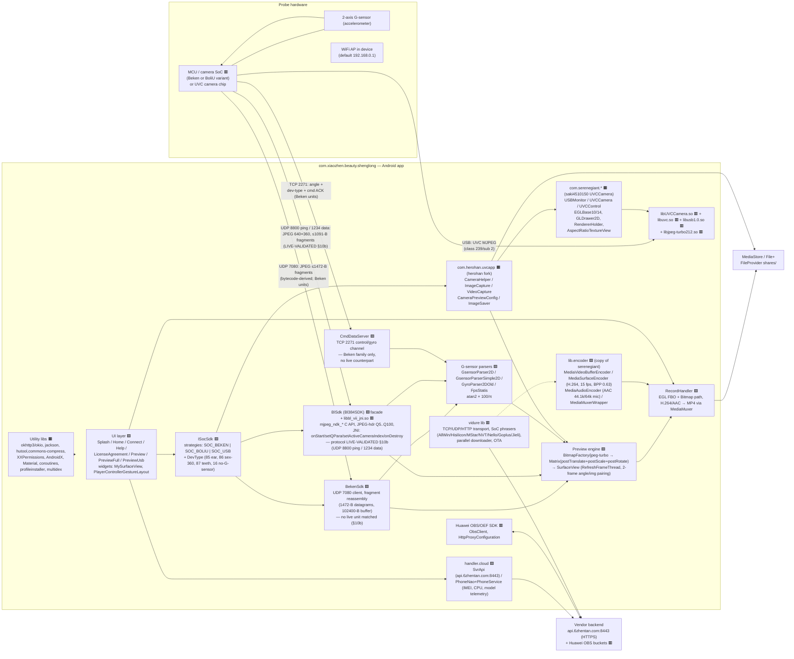
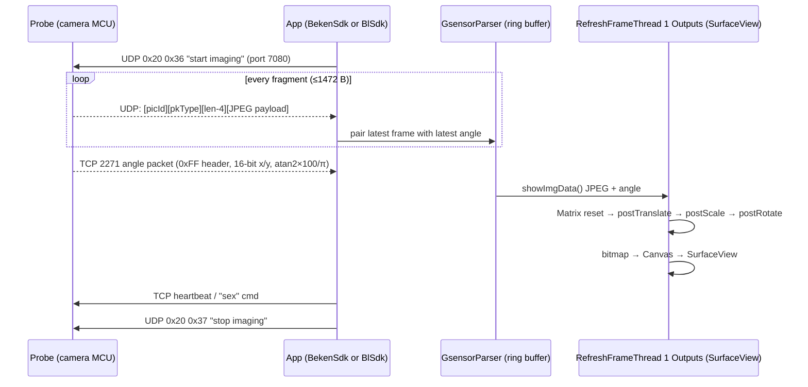
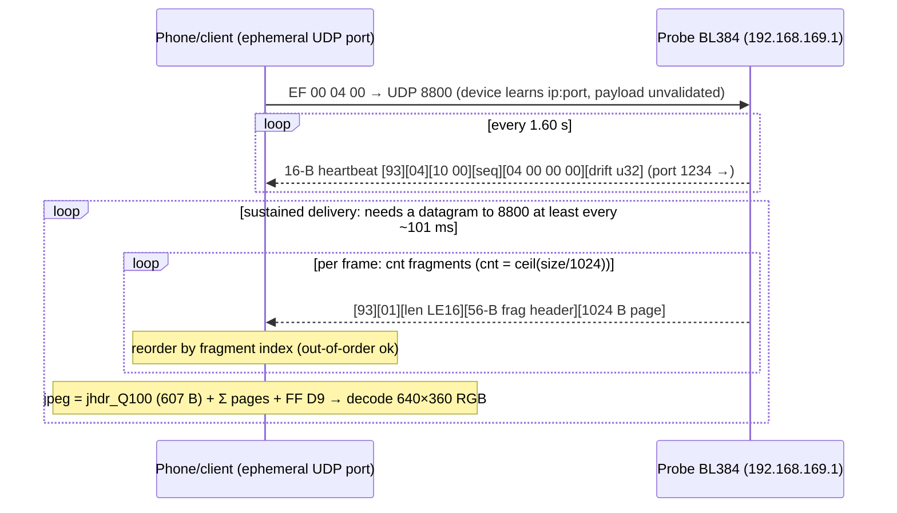
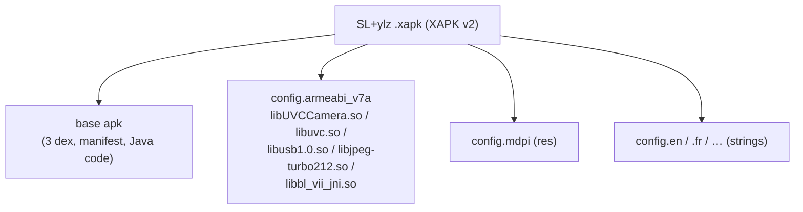

# Component & Building-Block Map — `SL+ylz` v1.0.23

All nodes are verified against DEX classes / native symbols / manifest entries of the analyzed APK. Legend: 🟥 vendor binary blob · 🟧 OSS library (bundled copy) · 🟩 in-house analysis base code

---

## 1. Overall architecture map



## 2. Information flow: video + orientation (WiFi probe)



*Key point:* angle packets are plainly asynchronous from the frames — the app does **nearest-lag pairing** because the G-sensor on device has no concept of frames. The result is a 2-buffer deep "sample & hold" that lets the visible frame *stand still* while the probe body rolls (intention: examine the ear canal as if fixed).

> **Live-unit caveat:** the sequence above is the *Beken-family/bytecode-derived* path. The delivered
> BoliU unit (§10b of the arc42 doc) runs a different exchange — see section 2a below — and streams **no
> orientation data at all**.

## 2a. Physical device trace (empirically validated, `04-live-device-validation.md` §3–§5b)

What actually happens on the wire with the delivered BL384/BoliU unit at `192.168.169.x`:



- Charakteristik: ping-serve (one ping ≈ one/frame-batch served), sticky stream target, bursty delivery
  (~25 fps intra-burst, ~0.5 s stalls), no TCP, no sensor channel, no configuration protocol.

## 3. USB/UVC path

```mermaid
flowchart LR
    USBD["UVC USB probe\n(class 0xEF/0x02 device filter)"] -- iso/bulk MJPEG --> LIBU["libuvc.so + libusb1.0.so"]
    LIBU -- "uvc frames (UVC_FRAME_FORMAT_MJPEG\nH264/YUYV/NV21 also in code)" --> LIBUV["libUVCCamera.so\n(UVCPreview NV21/GL)"]
    LIBUV →|JNI com.serenegiant.usb.UVCCamera| UVCAPP["herohan CameraHelper"]
    UVCAPP -- surface --> GL["EGLBase14 + RendererHolder + GLDrawer2D"]
    GL -- rotate btn (manual) --> VIEW["AspectRatioSurfaceView"]
    GL -- frames --> MEDIA["MediaCodec H.264 → MediaMuxer → MP4\n(+ AudioRecord → AAC)"]
    UVCAPP -- frame capture --> IMG["ImageCapture → JPEG still → FileProvider"]
```

## 4. Deployed packaging



## 5. Logical boundaries assessment

| Boundary | Where | Clean? | Notes |
|---|---|---|---|
| **App ↔ probe transport** | `ISocSdk` strategy (`SOC_BEKEN`/`SOC_BOLIU`/`SOC_USB`) | 🟢 good shape, hidden detail | Strategy factory is the right seam — and empirically **essential**: controller families carry their own wire protocols (Beken ≠ BoliU ≠ UVC, see §10b.9 of the arc42 doc); the FOSS design duplicates it as a pluggable `DeviceTransport`. Implementations leak device-type specifics into the UI. |
| **App ↔ orientation** | `lib.gyro.*` | 🟡 | Parser algorithm per device type is embedded; an interface (e.g. `IAttitudeSource`) is a better boundary. **The BoliU unit supplies no attitude data** — for such devices the source is phone-sensor or manual. |
| **App ↔ render pipeline** | `lib.opengl`, `PreserveActivity.RefreshFrameThread` | 🔴 | Rotation+scale+draw is duplicated in 2 activities against 2 different render paths (Bitmap Canvas vs GL). Not factored out. |
| **App ↔ capture/codec** | `lib.encoder` + `handler.RecordHandler` | 🔴 | This is a verbatim copy of the serenegiant sample code path AND another path in `com.herohan.uvcapp.VideoCapture` — two parallel implementations coexist. |
| **App ↔ OS** | `UsbManager`, `SensorManager`, `ConnectivityManager`, `MediaCodec`, `MediaMuxer`, `EGL`, `FileProvider`, `Storage Access` | 🟡 | No service abstraction: state lives in Activities; orientation/config changes handled by `configChanges`-freeze instead of lifecycle-aware design. |
| **App ↔ backend** | `handler.cloud.*` + OBS + vidure | 🟡 | Brand telemetry/push bundled directly into app classpath; no local persistence boundary; metadata pushed without lifecycle gate. |
| **Vendor blobs** | `libbl_vii_jni.so`, `libUVCCamera.so`+children | 🟢 resolved | ⚫ The BoliU UDP protocol was the mystery — **now fully reverse-engineered via black-box capture + native disassembly** (§10b, `04-live-device-validation.md`). `libUVCCamera.so` stays behind the OSS wrapper's documented JNI API, no need to reimplement. |
| **Dead/living code** | `vidure` transport (7 SoC families), OBS SDK, `jackson`+`hutool` (duplicated) | 🔴 | Huge unused/low-use code mass inflates APK & attack surface. |

## 6. Permission / manifest feature map

| Manifest element | Meaning |
|---|---|
| `<uses-feature android:hardware.usb.host>` + class-239 filter | Device is a plug-and-play UVC camera |
| `USB_DEVICE_ATTACHED/DETACHED` launcher filter | App is a USB attach home |
| `CHANGE_WIFI_STATE`, `ACCESS_WIFI_STATE`, `ACCESS_NETWORK_STATE` | WiFi AP switching/detection |
| `CAMERA` | Declared, but probe is not accessed through the camera HAL (legacy or WiFi-preview fallback only) |
| `READ/WRITE_EXTERNAL_STORAGE`, `READ_MEDIA_IMAGES/VIDEO` | Still/video storage on legacy path |
| `FOREGROUND_SERVICE` | Declared but no service found → likely dead |
| `android:usesCleartextTraffic=true` + empty TLS bypass | All HTTP is unverified |
